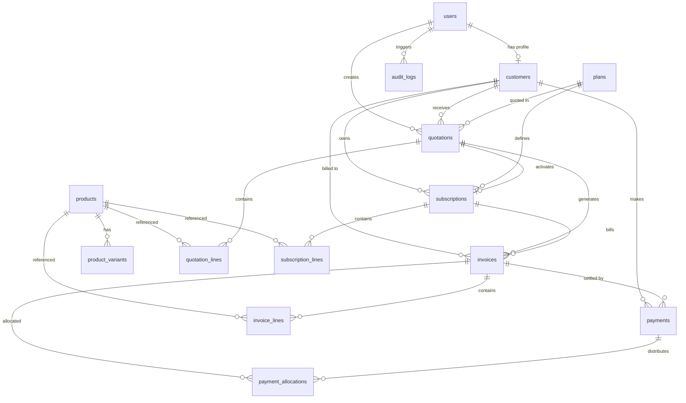

# SubFlow Database Schema & Architecture

This document defines the core PostgreSQL database schema for **SubFlow**, an enterprise-grade Subscription Management System developed for the Make-A-Ton 9.0 hackathon.

---

## 1. Entity Relationship Diagram (ERD)



---

## 2. Shared Models & Schema Reference

All monetary values are modeled using PostgreSQL **`NUMERIC(12, 2)`** to prevent IEEE 754 floating-point rounding errors in recurring subscription billing calculations. All timestamps use **`TIMESTAMP WITH TIME ZONE`** (UTC).

### 2.1 Users (`users`)
Central identity store supporting Role-Based Access Control (RBAC).

| Column | Type | Constraints | Description |
| :--- | :--- | :--- | :--- |
| `id` | `INTEGER` | `PRIMARY KEY`, `AUTO_INCREMENT` | Unique user identifier |
| `email` | `VARCHAR(255)` | `UNIQUE`, `NOT NULL`, `INDEX` | Login email address |
| `password_hash` | `VARCHAR(255)` | `NOT NULL` | Werkzeug salted PBKDF2/SHA256 hash |
| `first_name` | `VARCHAR(100)` | `NOT NULL` | First name |
| `last_name` | `VARCHAR(100)` | `NOT NULL` | Last name |
| `role` | `VARCHAR(50)` | `NOT NULL`, `DEFAULT 'customer'`, `INDEX` | RBAC Role: `admin`, `staff`, or `customer` |
| `is_active` | `BOOLEAN` | `NOT NULL`, `DEFAULT TRUE` | Active/deactivated flag |
| `created_at` | `TIMESTAMPTZ` | `NOT NULL`, `DEFAULT UTC_NOW` | Account creation timestamp |
| `updated_at` | `TIMESTAMPTZ` | `NOT NULL`, `DEFAULT UTC_NOW` | Last update timestamp |

### 2.2 Customers (`customers`)
Billing accounts and client organizational profiles.

| Column | Type | Constraints | Description |
| :--- | :--- | :--- | :--- |
| `id` | `INTEGER` | `PRIMARY KEY`, `AUTO_INCREMENT` | Unique customer account ID |
| `user_id` | `INTEGER` | `FOREIGN KEY (users.id) ON DELETE SET NULL`, `UNIQUE`, `NULLABLE` | Optional linked user login |
| `company_name` | `VARCHAR(255)` | `NOT NULL`, `INDEX` | Legal entity or business name |
| `contact_name` | `VARCHAR(255)` | `NOT NULL` | Primary contact person |
| `email` | `VARCHAR(255)` | `NOT NULL`, `INDEX` | Billing contact email |
| `phone` | `VARCHAR(50)` | `NULLABLE` | Contact telephone number |
| `billing_street`| `VARCHAR(255)` | `NULLABLE` | Street address |
| `billing_city` | `VARCHAR(100)` | `NULLABLE` | City |
| `billing_state`| `VARCHAR(100)` | `NULLABLE` | State or province |
| `billing_postal_code` | `VARCHAR(50)` | `NULLABLE` | ZIP or postal code |
| `billing_country` | `VARCHAR(100)` | `NOT NULL`, `DEFAULT 'United States'` | ISO / country name |
| `currency` | `VARCHAR(10)` | `NOT NULL`, `DEFAULT 'USD'` | Default invoicing currency |
| `vat_number` | `VARCHAR(50)` | `NULLABLE` | Tax or VAT registration identifier |
| `payment_terms_days` | `INTEGER` | `NOT NULL`, `DEFAULT 30` | Net payment terms (e.g. 15, 30, 60 days) |
| `credit_limit` | `NUMERIC(12, 2)`| `NOT NULL`, `DEFAULT 0.00` | Account credit allowance |
| `is_active` | `BOOLEAN` | `NOT NULL`, `DEFAULT TRUE` | Customer status |
| `notes` | `TEXT` | `NULLABLE` | Internal account notes |
| `created_at` | `TIMESTAMPTZ` | `NOT NULL` | Record creation timestamp |
| `updated_at` | `TIMESTAMPTZ` | `NOT NULL` | Record update timestamp |

### 2.3 Products & Product Variants (`products`, `product_variants`)
Product catalog supporting recurring subscription components and one-time add-ons.

#### `products`
| Column | Type | Constraints | Description |
| :--- | :--- | :--- | :--- |
| `id` | `INTEGER` | `PRIMARY KEY` | Product ID |
| `name` | `VARCHAR(255)` | `NOT NULL`, `INDEX` | Commercial product name |
| `sku` | `VARCHAR(100)` | `UNIQUE`, `NOT NULL`, `INDEX` | Stock Keeping Unit / catalog code |
| `description` | `TEXT` | `NULLABLE` | Extended product description |
| `is_recurring` | `BOOLEAN` | `NOT NULL`, `DEFAULT TRUE` | Recurring subscription vs one-off |
| `is_active` | `BOOLEAN` | `NOT NULL`, `DEFAULT TRUE` | Sellable status |
| `default_price`| `NUMERIC(12, 2)`| `NOT NULL`, `DEFAULT 0.00` | Base catalog unit price |
| `currency` | `VARCHAR(10)` | `NOT NULL`, `DEFAULT 'USD'` | Price currency |
| `unit_of_measure` | `VARCHAR(50)`| `NOT NULL`, `DEFAULT 'unit'` | E.g. 'seat', 'unit', 'GB', 'month' |

#### `product_variants`
| Column | Type | Constraints | Description |
| :--- | :--- | :--- | :--- |
| `id` | `INTEGER` | `PRIMARY KEY` | Variant ID |
| `product_id` | `INTEGER` | `FOREIGN KEY (products.id) ON DELETE CASCADE`, `NOT NULL` | Parent product reference |
| `sku` | `VARCHAR(100)` | `UNIQUE`, `NOT NULL` | Variant-specific SKU |
| `name` | `VARCHAR(255)` | `NOT NULL` | Variant name (e.g., '100GB Storage Tier') |
| `attributes` | `JSONB / JSON` | `NOT NULL`, `DEFAULT '{}'` | Structured dimensions (tier, region, etc.) |
| `price_extra` | `NUMERIC(12, 2)`| `NOT NULL`, `DEFAULT 0.00` | Surcharge over base product price |
| `is_active` | `BOOLEAN` | `NOT NULL`, `DEFAULT TRUE` | Active variant flag |

### 2.4 Subscription Plans (`plans`)
Recurring packaging tiers defining cadences, pricing, and trial periods.

| Column | Type | Constraints | Description |
| :--- | :--- | :--- | :--- |
| `id` | `INTEGER` | `PRIMARY KEY` | Plan ID |
| `name` | `VARCHAR(255)` | `NOT NULL` | Plan name (e.g. 'Starter', 'Professional') |
| `code` | `VARCHAR(100)` | `UNIQUE`, `NOT NULL`, `INDEX` | System code (e.g. `PLAN-STARTER-MO`) |
| `description` | `TEXT` | `NULLABLE` | Plan summary |
| `billing_interval` | `VARCHAR(50)` | `NOT NULL`, `DEFAULT 'monthly'` | Cadence: `monthly`, `quarterly`, `yearly` |
| `billing_interval_count` | `INTEGER` | `NOT NULL`, `DEFAULT 1` | Frequency multiplier |
| `base_price` | `NUMERIC(12, 2)`| `NOT NULL`, `DEFAULT 0.00` | Recurring price per cycle |
| `setup_fee` | `NUMERIC(12, 2)`| `NOT NULL`, `DEFAULT 0.00` | One-time onboarding/setup charge |
| `currency` | `VARCHAR(10)` | `NOT NULL`, `DEFAULT 'USD'` | Plan currency |
| `trial_days` | `INTEGER` | `NOT NULL`, `DEFAULT 0` | Complimentary trial period days |
| `features` | `JSONB / JSON` | `NOT NULL`, `DEFAULT '[]'` | List of included plan bullet points |
| `is_active` | `BOOLEAN` | `NOT NULL`, `DEFAULT TRUE` | Available for new subscriptions |

### 2.5 Quotations & Quotation Lines (`quotations`, `quotation_lines`)
Sales proposals and custom pricing estimates converted into active subscriptions.

#### `quotations`
| Column | Type | Constraints | Description |
| :--- | :--- | :--- | :--- |
| `id` | `INTEGER` | `PRIMARY KEY` | Quotation ID |
| `quotation_number` | `VARCHAR(100)`| `UNIQUE`, `NOT NULL`, `INDEX` | Reference number (e.g., `QT-2026-0001`) |
| `customer_id` | `INTEGER` | `FOREIGN KEY (customers.id) ON DELETE CASCADE`, `NOT NULL` | Recipient client |
| `plan_id` | `INTEGER` | `FOREIGN KEY (plans.id) ON DELETE SET NULL`, `NULLABLE` | Associated subscription plan |
| `created_by_id` | `INTEGER` | `FOREIGN KEY (users.id) ON DELETE SET NULL`, `NULLABLE` | Authoring staff/admin |
| `status` | `VARCHAR(50)` | `NOT NULL`, `DEFAULT 'draft'`, `INDEX` | `draft`, `sent`, `approved`, `rejected`, `expired` |
| `issue_date` | `DATE` | `NOT NULL` | Date quotation was issued |
| `valid_until` | `DATE` | `NOT NULL` | Expiration date |
| `currency` | `VARCHAR(10)` | `NOT NULL`, `DEFAULT 'USD'` | Currency code |
| `subtotal` | `NUMERIC(12, 2)`| `NOT NULL`, `DEFAULT 0.00` | Pre-discount, pre-tax total |
| `discount_amount` | `NUMERIC(12, 2)`| `NOT NULL`, `DEFAULT 0.00` | Total discount reduction |
| `tax_amount` | `NUMERIC(12, 2)`| `NOT NULL`, `DEFAULT 0.00` | Estimated taxes |
| `total_amount` | `NUMERIC(12, 2)`| `NOT NULL`, `DEFAULT 0.00` | Final quotation total |
| `terms_and_conditions`| `TEXT` | `NULLABLE` | Specific contractual clauses |

#### `quotation_lines`
| Column | Type | Constraints | Description |
| :--- | :--- | :--- | :--- |
| `id` | `INTEGER` | `PRIMARY KEY` | Line item ID |
| `quotation_id`| `INTEGER` | `FOREIGN KEY (quotations.id) ON DELETE CASCADE` | Parent quotation |
| `product_id` | `INTEGER` | `FOREIGN KEY (products.id) ON DELETE RESTRICT` | Referenced catalog product |
| `product_variant_id` | `INTEGER` | `FOREIGN KEY (product_variants.id) ON DELETE SET NULL` | Optional variant |
| `description` | `VARCHAR(255)`| `NOT NULL` | Item description |
| `quantity` | `NUMERIC(10, 2)`| `NOT NULL`, `DEFAULT 1.00` | Billed quantity |
| `unit_price` | `NUMERIC(12, 2)`| `NOT NULL` | Unit price |
| `discount_percent` | `NUMERIC(5, 2)` | `NOT NULL`, `DEFAULT 0.00` | Line item discount percent |
| `total_amount`| `NUMERIC(12, 2)`| `NOT NULL` | Line total after discount |

### 2.6 Subscriptions & Lines (`subscriptions`, `subscription_lines`)
Contractual recurring subscription lifecycles.

#### `subscriptions`
| Column | Type | Constraints | Description |
| :--- | :--- | :--- | :--- |
| `id` | `INTEGER` | `PRIMARY KEY` | Subscription ID |
| `subscription_number` | `VARCHAR(100)`| `UNIQUE`, `NOT NULL`, `INDEX` | Code (e.g., `SUB-2026-0001`) |
| `customer_id` | `INTEGER` | `FOREIGN KEY (customers.id) ON DELETE CASCADE`, `NOT NULL` | Subscribing customer |
| `plan_id` | `INTEGER` | `FOREIGN KEY (plans.id) ON DELETE RESTRICT`, `NOT NULL` | Recurring plan tier |
| `quotation_id`| `INTEGER` | `FOREIGN KEY (quotations.id) ON DELETE SET NULL`, `NULLABLE` | Originating quotation |
| `status` | `VARCHAR(50)` | `NOT NULL`, `DEFAULT 'draft'`, `INDEX` | `draft`, `active`, `paused`, `cancelled`, `expired` |
| `start_date` | `DATE` | `NOT NULL` | Subscription commencement date |
| `current_period_start` | `DATE` | `NOT NULL` | Current billing period start |
| `current_period_end` | `DATE` | `NOT NULL` | Current billing period end |
| `trial_end` | `DATE` | `NULLABLE` | Trial termination date |
| `next_billing_date` | `DATE` | `NULLABLE`, `INDEX` | Date next invoice will generate |
| `auto_renew` | `BOOLEAN` | `NOT NULL`, `DEFAULT TRUE` | Automatic renewal flag |
| `recurring_amount` | `NUMERIC(12, 2)`| `NOT NULL`, `DEFAULT 0.00` | Regular charge per period |
| `currency` | `VARCHAR(10)` | `NOT NULL`, `DEFAULT 'USD'` | Currency |

### 2.7 Invoices & Lines (`invoices`, `invoice_lines`)
Accounts receivable ledger and billing statements.

#### `invoices`
| Column | Type | Constraints | Description |
| :--- | :--- | :--- | :--- |
| `id` | `INTEGER` | `PRIMARY KEY` | Invoice ID |
| `invoice_number` | `VARCHAR(100)`| `UNIQUE`, `NOT NULL`, `INDEX` | Unique reference (e.g. `INV-2026-0001`) |
| `customer_id` | `INTEGER` | `FOREIGN KEY (customers.id) ON DELETE CASCADE`, `NOT NULL` | Billed customer |
| `subscription_id` | `INTEGER` | `FOREIGN KEY (subscriptions.id) ON DELETE SET NULL`, `NULLABLE` | Source subscription |
| `status` | `VARCHAR(50)` | `NOT NULL`, `DEFAULT 'draft'`, `INDEX` | `draft`, `posted`, `paid`, `partial`, `overdue`, `cancelled` |
| `invoice_date`| `DATE` | `NOT NULL` | Date of invoice issuance |
| `due_date` | `DATE` | `NOT NULL`, `INDEX` | Payment due date |
| `currency` | `VARCHAR(10)` | `NOT NULL`, `DEFAULT 'USD'` | Currency |
| `subtotal` | `NUMERIC(12, 2)`| `NOT NULL`, `DEFAULT 0.00` | Net amount |
| `discount_amount`| `NUMERIC(12, 2)`| `NOT NULL`, `DEFAULT 0.00` | Total discount |
| `tax_amount` | `NUMERIC(12, 2)`| `NOT NULL`, `DEFAULT 0.00` | Total tax |
| `total_amount`| `NUMERIC(12, 2)`| `NOT NULL`, `DEFAULT 0.00` | Grand total |
| `amount_paid` | `NUMERIC(12, 2)`| `NOT NULL`, `DEFAULT 0.00` | Payments received |
| `balance_due` | `NUMERIC(12, 2)`| `NOT NULL`, `DEFAULT 0.00` | Remaining unpaid balance |
| `payment_terms`| `VARCHAR(100)`| `DEFAULT 'Net 30'` | Terms description |

### 2.8 Discount Rules (`discount_rules`)
Promotions and coupon validation rules engine.

| Column | Type | Constraints | Description |
| :--- | :--- | :--- | :--- |
| `id` | `INTEGER` | `PRIMARY KEY` | Discount rule ID |
| `code` | `VARCHAR(50)` | `UNIQUE`, `NOT NULL`, `INDEX` | Promo code (e.g., `SAVE20`, `WELCOME10`) |
| `name` | `VARCHAR(255)` | `NOT NULL` | Promotion campaign title |
| `discount_type`| `VARCHAR(20)`| `NOT NULL`, `DEFAULT 'percentage'` | `percentage` or `fixed` |
| `value` | `NUMERIC(12, 2)`| `NOT NULL` | Value (20.00 for 20% or $20.00) |
| `min_order_amount` | `NUMERIC(12, 2)`| `NOT NULL`, `DEFAULT 0.00` | Minimum order qualifier |
| `max_discount_amount`| `NUMERIC(12, 2)`| `NULLABLE` | Ceiling cap on percentage discounts |
| `valid_from` | `TIMESTAMPTZ` | `NULLABLE` | Campaign start timestamp |
| `valid_to` | `TIMESTAMPTZ` | `NULLABLE` | Campaign expiry timestamp |
| `max_uses` | `INTEGER` | `NULLABLE` | Total redemption allowance |
| `current_uses`| `INTEGER` | `NOT NULL`, `DEFAULT 0` | Current redemption counter |
| `applicable_plans` | `JSONB / JSON` | `NOT NULL`, `DEFAULT '[]'` | Specific plan codes eligible |
| `is_active` | `BOOLEAN` | `NOT NULL`, `DEFAULT TRUE` | Enabled flag |

### 2.9 Payments & Allocations (`payments`, `payment_allocations`)
Customer payment transactions and reconciliation against invoice balances.

#### `payments`
| Column | Type | Constraints | Description |
| :--- | :--- | :--- | :--- |
| `id` | `INTEGER` | `PRIMARY KEY` | Payment ID |
| `payment_number` | `VARCHAR(100)`| `UNIQUE`, `NOT NULL`, `INDEX` | Transaction ID (e.g. `PAY-2026-0001`) |
| `customer_id` | `INTEGER` | `FOREIGN KEY (customers.id) ON DELETE CASCADE` | Paying customer |
| `invoice_id` | `INTEGER` | `FOREIGN KEY (invoices.id) ON DELETE SET NULL` | Primary associated invoice |
| `amount` | `NUMERIC(12, 2)`| `NOT NULL`, `DEFAULT 0.00` | Collected transaction amount |
| `currency` | `VARCHAR(10)` | `NOT NULL`, `DEFAULT 'USD'` | Currency |
| `payment_method` | `VARCHAR(50)` | `NOT NULL`, `DEFAULT 'credit_card'` | `credit_card`, `bank_transfer`, `stripe`, `cash` |
| `status` | `VARCHAR(50)` | `NOT NULL`, `DEFAULT 'completed'`, `INDEX` | `pending`, `completed`, `failed`, `refunded` |
| `transaction_reference` | `VARCHAR(255)`| `NULLABLE`, `INDEX` | Gateway charge ID |
| `payment_date`| `TIMESTAMPTZ` | `NOT NULL` | Settlement timestamp |

#### `payment_allocations`
| Column | Type | Constraints | Description |
| :--- | :--- | :--- | :--- |
| `id` | `INTEGER` | `PRIMARY KEY` | Allocation ID |
| `payment_id` | `INTEGER` | `FOREIGN KEY (payments.id) ON DELETE CASCADE` | Source payment |
| `invoice_id` | `INTEGER` | `FOREIGN KEY (invoices.id) ON DELETE CASCADE` | Target invoice |
| `amount_allocated` | `NUMERIC(12, 2)`| `NOT NULL` | Portion of payment allocated |

### 2.10 Audit Logs (`audit_logs`)
Immutable regulatory trail tracking administrative and operational changes.

| Column | Type | Constraints | Description |
| :--- | :--- | :--- | :--- |
| `id` | `INTEGER` | `PRIMARY KEY` | Log entry ID |
| `user_id` | `INTEGER` | `FOREIGN KEY (users.id) ON DELETE SET NULL` | Performing user |
| `action` | `VARCHAR(100)`| `NOT NULL`, `INDEX` | E.g. `USER_LOGIN`, `STAFF_CREATED` |
| `entity_type` | `VARCHAR(100)`| `NOT NULL`, `INDEX` | Target table (e.g. `Subscription`, `Invoice`) |
| `entity_id` | `VARCHAR(100)`| `NULLABLE` | Primary key of affected record |
| `old_values` | `JSONB / JSON` | `NULLABLE` | State before modification |
| `new_values` | `JSONB / JSON` | `NULLABLE` | State after modification |
| `ip_address` | `VARCHAR(50)` | `NULLABLE` | Client IP address |
| `user_agent` | `VARCHAR(255)`| `NULLABLE` | Browser / client identifier |
| `created_at` | `TIMESTAMPTZ` | `NOT NULL`, `INDEX` | Event timestamp |

---

## 3. Migration and Neon PostgreSQL Configuration

### 3.1 Configuring Neon Connection
Set the `DATABASE_URL` environment variable in your `backend/.env` file:
```env
DATABASE_URL=postgresql://<user>:<password>@<neon-host>.aws.neon.tech/<dbname>?sslmode=require
```

### 3.2 Running Migrations
Flask-Migrate manages Alembic migration files under `backend/migrations/versions/`.

```bash
# Set Flask application entry point
$env:FLASK_APP="backend.app"   # Windows PowerShell
export FLASK_APP=backend.app   # Linux/macOS

# Apply latest schema migrations
flask db upgrade -d backend/migrations

# Seed initial demo accounts and starter products/plans
flask seed
```
