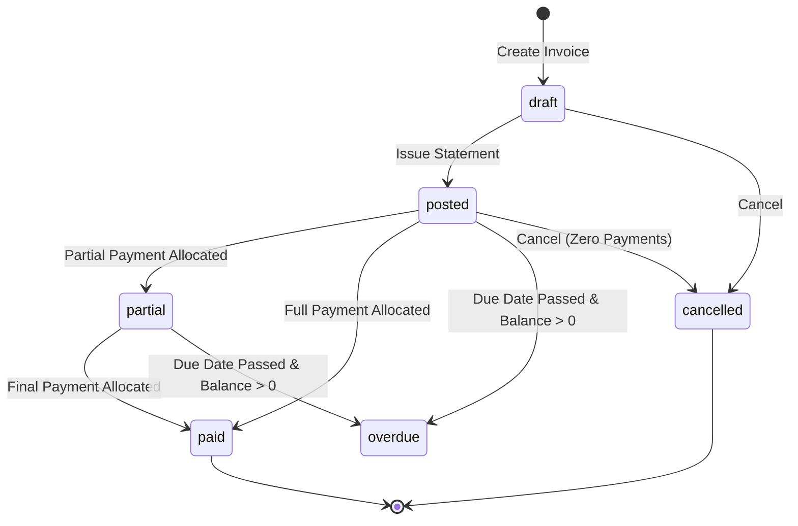

# SubFlow Invoicing & Recurring Billing Engine

## 1. Overview
The **Invoicing and Recurring Billing** module in SubFlow handles automated receivables, line item calculations using PostgreSQL `Numeric(12, 2)` decimal precision, unique sequence numbering, lifecycle status management, and scheduled recurring billing runs.

---

## 2. Invoice Lifecycle & Status Transitions

Persisted status values adhere to the database schema:
- `draft`: Initial statement drafted by staff/admin. Lines and notes can be edited.
- `posted`: Issued statement visible to customer; balance due is active in accounts receivable ledger.
- `partial`: Partially paid invoice with remaining unpaid balance (`0 < amount_paid < total_amount`).
- `paid`: Settled statement (`balance_due == 0.00`).
- `overdue`: Outstanding statement whose `due_date < today`.
- `cancelled`: Revoked statement. Only unpaid invoices with zero allocated funds can be cancelled.



---

## 3. Decimal Financial Calculations
All calculations use Python `Decimal` with `ROUND_HALF_UP` precision to prevent floating-point rounding errors:

$$\text{Line Total} = \text{round}\left(\text{Quantity} \times \text{Unit Price} \times \left(1 - \frac{\text{Discount \%}}{100}\right), 2\right)$$

$$\text{Subtotal} = \sum \text{Line Totals}$$

$$\text{Total Amount} = \max(0, \text{Subtotal} - \text{Discount Amount} + \text{Tax Amount})$$

$$\text{Balance Due} = \max(0, \text{Total Amount} - \text{Amount Paid})$$

---

## 4. Recurring Billing Engine & Duplicate Prevention

### 4.1 Eligible Subscriptions
A subscription generates an invoice when:
1. `status == 'active'`
2. `auto_renew == True`
3. `next_billing_date <= target_date` (defaults to today)
4. Not in active trial (`trial_end is None or trial_end <= target_date`)

### 4.2 Idempotency & Duplicate Prevention
To guarantee that recurring billing never charges a customer twice for the same billing cycle:
1. An uncancelled invoice check searches for existing invoices with `subscription_id` and matching `invoice_date`.
2. Once generated, the subscription's `current_period_start`, `current_period_end`, and `next_billing_date` are advanced based on `plan.billing_interval` (`daily`, `weekly`, `monthly`, `quarterly`, `yearly`) and `billing_interval_count`.
3. Database transactions commit per subscription with rollback on exception so individual failures do not disrupt the entire billing run.

### 4.3 Manual & Scheduled CLI Invocation
External crons (e.g., cron, AWS EventBridge, Celery) can invoke the engine via CLI:
```bash
# Set Flask application
export FLASK_APP=backend.app

# Run recurring billing for today
flask recurring-billing

# Or dry-run preview:
flask recurring-billing --dry-run
```

Or via REST API:
```http
POST /api/v1/invoices/recurring-billing/run
Authorization: Bearer <staff_or_admin_token>
Content-Type: application/json

{
  "target_date": "2026-10-31",
  "dry_run": false
}
```

---

## 5. API Endpoints Reference

| Method | Endpoint | Access | Description |
| :--- | :--- | :--- | :--- |
| `GET` | `/api/v1/invoices` | Admin, Staff, Customer | Paginated list with status, customer, search, and overdue filtering. Customers isolated to own account. |
| `POST` | `/api/v1/invoices` | Admin, Staff | Create validated invoice with multiple lines. Recalculated on backend. |
| `GET` | `/api/v1/invoices/<id>` | Admin, Staff, Customer | Detailed view with lines, customer profile, and payment allocation history. |
| `POST` | `/api/v1/invoices/<id>/issue` | Admin, Staff | Issue draft invoice (`draft` $\rightarrow$ `posted`). |
| `POST` | `/api/v1/invoices/<id>/cancel` | Admin, Staff | Cancel unpaid invoice. |
| `POST` | `/api/v1/invoices/from-subscription/<id>` | Admin, Staff | Instant invoice generation from an active subscription. |
| `POST` | `/api/v1/invoices/recurring-billing/run` | Admin, Staff | Execute recurring billing job. |
| `GET` | `/api/v1/invoices/recurring-billing/preview` | Admin, Staff | Dry-run preview of due subscriptions. |
| `GET` | `/api/v1/invoices/receivables/summary` | Admin, Staff, Customer | Total receivables, aging analysis, and overdue metrics. |
| `GET` | `/api/v1/invoices/customers` | Admin, Staff | Active customer dropdown list for invoice generation. |
